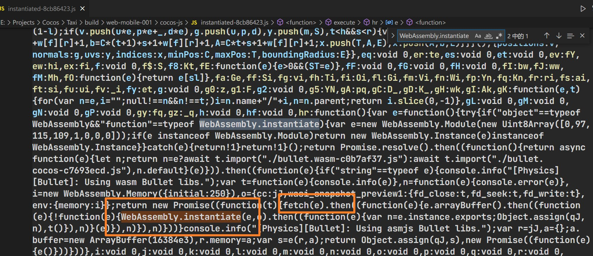
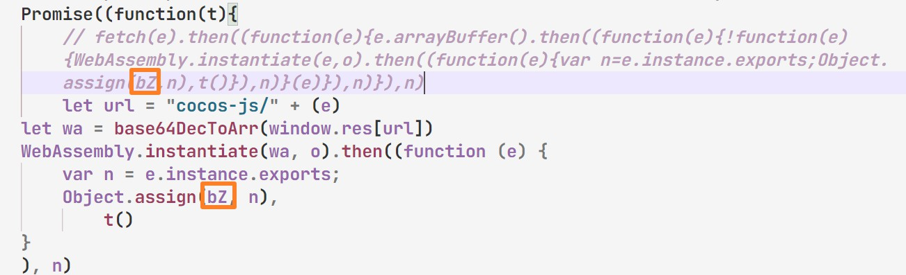

# CocosCreator ثلاثي الأبعاد قابل للتشغيل

### [تم التعديل بناءً على هذا المشروع](https://github.com/Jecced/c3d2one)

### شكرا مرة أخرى لهذا الرجل لمشروعه

## وصف التمهيدي

-   [إنجليزي](README.en.md)
-   [الصينية المبسطة](README.zh-CN.md)
-   [الصينية التقليدية](README.zh-TW.md)
-   [الهندية](README.hi.md)
-   [فرنسي](README.fr.md)
-   [عربى](README.ar.md)

### النسخة التاريخية

## [كوكوس كرياتور3D 3.2.0](./version/Version%203.2.0.md)

## [كوكوس كرياتور 3D 3.4.1](./version/Version%203.4.1.md)

## مبدأ الإنتاج

### لأنه تم استخدام CocosCreator منذ الإصدار ثلاثي الأبعاد[SystemJS](https://github.com/systemjs/systemjs)لتحميل جميع موارد البرامج النصية، ولكن الطريقة التي يقوم بها SystemJS بتحميل البرامج النصية هي من خلال طلبات الويب (ربما تكون الطريقة غير صحيحة)، ولكن الشرط الأساسي لإنتاج الإعلانات القابلة للتشغيل هو عدم السماح بتحميل الموارد من خلال طلبات الشبكة. يجب أن تكون جميع الموارد ذات الصلة في نفس ملف Html، لذلك تم تحميل الإصدار الأول عن طريق تعديل SystemJS. ومع ذلك، بعد العديد من الاختبارات (لفترة طويلة)، تم العثور على بعض الطرق الذكية جدًا، والتي يمكن القيام بها دون تعديل SystemJS.

#### [تسجيل النظام](https://github.com/systemjs/systemjs/blob/main/docs/system-register.md)

بعد تصدير CocosCreator3D لمشروع ويب الهاتف المحمول، تتميز العديد من البرامج النصية المتعلقة بالنظام بالخصائص التالية. بالنسبة للنصوص البرمجية المسجلة في SystemJS، يحتوي المصفوفة الأولى على تبعيات تمثل تلك الوحدات التي تعتمد عليها. سيتم تحميل الوحدات التابعة أولاً.

```javascript
System.register(['dependency'], function (_export, _context) {
  var dep;
  return {
    setters: [function (_dep) {
      dep = _dep;
    }],
    execute: function () {
      _export({
        name: 'value'
      });
    }
  };
});
```

ثم يمكن تمرير المعلمة الأولى للأسلوب System.register في سلسلة، والتي أسميها اسمًا مستعارًا. عادةً ما يكون هذا هو اسم ملف js بالإضافة إلى المسار المقابل. نظرًا لوجود العديد من ملفات js بنفس اسم الملف، ستتم معالجتها وفقًا لذلك، كما يلي. على سبيل المثال، إذا كان الملف js هو PPS.js، فيمكن تعديله على النحو التالي:

```javascript
System.register('./PPS.js'，['./PPY.js'], function (_export, _context) {
  var dep;
  return {
    setters: [function (_dep) {
      dep = _dep;
    }],
    execute: function () {
      _export({
        name: 'value'
      });
    }
  };
});
```

ما ورد أعلاه يعني أنه عند تحميل PPS.js، سيتم تحميل ملف PPY.js أولاً، ثم سيتم تحميل PPS.js.
يوجد أدناه ملف PPYjs،

```javascript
System.register('./PPY.js'，[], function (_export, _context) {
  var dep;
  return {
    setters: [function (_dep) {
      dep = _dep;
    }],
    execute: function () {
      _export({
        name: 'value'
      });
    }
  };
});
```

ثم أدخل PPY.js وPPS.js في ملف Html، على غرار ما يلي

```html

<script>
  System.register('./PPS.js'，['./PPY.js'], function (_export, _context) {
  var dep;
  return {
    setters: [function (_dep) {
      dep = _dep;
    }],
    execute: function () {
      _export({
        name: 'value'
      });
    }
  };
});
</script>
<script>
   System.register('./PPY.js'，[], function (_export, _context) {
  var dep;
  return {
    setters: [function (_dep) {
      dep = _dep;
    }],
    execute: function () {
      _export({
        name: 'value'
      });
    }
  };
});
</script>
<script>
   System.import('./PPS.js').catch(function (err) {
        console.error(err);
    })
</script>
```

(إذا كنت تريد تشغيل المثال بشكل طبيعي، فإن الفرضية هي حقن وحدة SystemJS، وإلا فلن تعمل بشكل طبيعي) سيتم تنفيذ الكود الموجود في الأسفل بنجاح

ما ورد أعلاه هو مثال بسيط. يستخدم هذا المشروع هذه الطريقة لإجراء الكثير من المعالجة المقابلة ثم يقوم بإنشاء ملف Html واحد.

## معالجة ملف التحميل WASM

نظرًا لأنك قد تحتاج إلى وحدة محرك فيزيائي، يمكنك أيضًا اختيار وحدة WASM. في هذه الحالة، تحتاج إلى تعديل الكود المصدري للمحرك (افتح "project Directory/build/web-mobile/cocos-js/instantiated-\*\*.js" المشابه لهذا الملف)
البحث عن الحقول الرئيسية

```javascript
WebAssembly.instantiate()
```

كما هو موضح في الصورة، ستجد أن طريقة الجلب مستخدمة في البرنامج النصي، وهو أمر غير مسموح به بواسطة PlayableAD، لذلك يمكنك فقط تغيير طريقة الجلب المقابلة واستبدالها كما يلي (عنوان المسار يأتي من[معالجة مسار WASM الوارد](./README.md#wasm路径传入处理))

من الضروري الانتباه إلى المواقف التالية (مهم جدًا) حيث يجب أن تكون الأماكن المحددة هي نفسها التي يتم جلبها، لأن أسماء المتغيرات المقابلة سيتم تغييرها في كل مرة تقوم فيها بالتجميع.

```javascript
let url = "cocos-js/" + (e)
let wa = base64DecToArr(window.res[url])
WebAssembly.instantiate(wa, o).then((function (e) {
    var n = e.instance.exports;
    Object.assign(qJ, n),
        t()
}
), n) 
```

يحصل هذا البرنامج النصي على مسار مورد Wasm الوارد. كافة الموارد النصية والموارد الثنائية موجودة في window.res.

## معالجة مسار WASM الوارد

افتح "دليل المشروع/build/web-mobile/cocos-js/bullet.wasm-\*\*\*\*.js" المشابه لهذا الملف

```javascript
System.register([],(function(e,t){"use strict";return{execute:function(){
  e("default",new URL("assets/bullet.wasm-c98527b6.wasm",t.meta.url).href)}
  }}));

```

استبدل المعلمة الكاملة لـ "new URL()" بـ "assets/bullet.wasm-c98527b6.wasm"، وهو أمر جيد جدًا. يجب ألا يتغير اسم ملف Wasm في الإصدار CocosCreator3D 3.4.1 عند التغليف (إذا كان هناك أي تعديل، يرجى استبداله باسم الملف الصحيح)
على النحو التالي:

```javascript
System.register([],(function(e,t){"use strict";return{execute:function(){
    e("default","assets/bullet.wasm-c98527b6.wasm")
}}}));

```

# الإجراءات التي يجب القيام بها

[معالجة التحميل](./README.md#wasm加载文件处理)\|[معالجة مسار WASM الوارد](./README.md#wasm路径传入处理)هذه العملية ضرورية لأنه يتم استخدام طريقة تشغيل جلب JavaScript، والتي يمكنها فقط فرض تعديل كود مصدر المحرك (يمكن تجاهلها إذا لم يتم استخدام Wasm)
