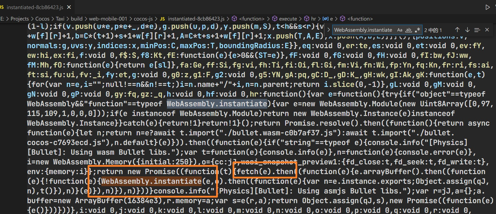
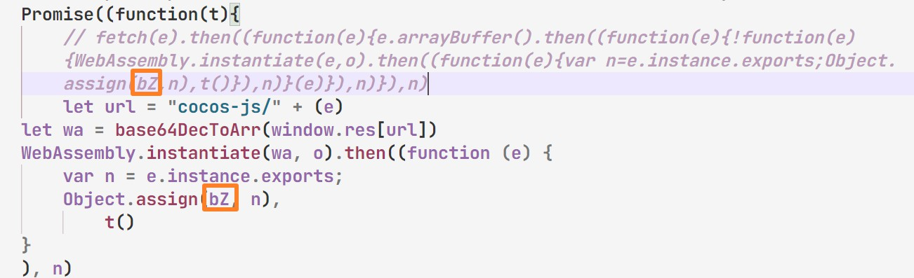

# CocosCreator3D PlayableAD

### [Modified based on this project](https://github.com/Jecced/c3d2one)

### Thanks again to this guy for his project

## README description

-   [English](README.en.md)
-   [Simplified Chinese](README.zh-CN.md)
-   [Traditional Chinese](README.zh-TW.md)
-   [Hindi](README.hi.md)
-   [Française](README.fr.md)
-   [Arab](README.ar.md)

### Historical version

## [CocosCreator3D 3.2.0](./version/Version%203.2.0.md)

## [CocosCreator3D 3.4.1](./version/Version%203.4.1.md)

## Production principle

### Because CocosCreator has been used since the 3d version[SystemJS](https://github.com/systemjs/systemjs)to load all script resources, but the way SystemJS loads scripts is through web requests (maybe the method is incorrect), but the prerequisite for Playable ad production is that resources are not allowed to be loaded through network requests. All related resources must be in the same Html file, so the early version was loaded by modifying SystemJS. However, after many tests (for a long time), some very clever methods were found, which can be done without modifying SystemJS.

#### [System.register](https://github.com/systemjs/systemjs/blob/main/docs/system-register.md)

After CocosCreator3D exports the mobile web project, many system-related scripts in it have the following characteristics. For scripts registered with SystemJS, the first array contains dependencies, which represent those modules that depend on them. Dependent modules will be loaded first.

```javascript
System.register(['dependency'], function (_export, _context) {
  var dep;
  return {
    setters: [function (_dep) {
      dep = _dep;
    }],
    execute: function () {
      _export({
        name: 'value'
      });
    }
  };
});
```

Then the first parameter of the System.register method can be passed in a string, which I call an alias. It is usually the name of the js file plus the corresponding path. Because there are many js files with the same file name, these will be processed accordingly, like the following. For example, if the js file is PPS.js, it can be modified as follows:

```javascript
System.register('./PPS.js'，['./PPY.js'], function (_export, _context) {
  var dep;
  return {
    setters: [function (_dep) {
      dep = _dep;
    }],
    execute: function () {
      _export({
        name: 'value'
      });
    }
  };
});
```

The above means that when PPS.js is loaded, the PPY.js file will be loaded first, and then PPS.js will be loaded.
Below is the PPYjs file,

```javascript
System.register('./PPY.js'，[], function (_export, _context) {
  var dep;
  return {
    setters: [function (_dep) {
      dep = _dep;
    }],
    execute: function () {
      _export({
        name: 'value'
      });
    }
  };
});
```

Then inject PPY.js and PPS.js into the Html file, similar to the following

```html

<script>
  System.register('./PPS.js'，['./PPY.js'], function (_export, _context) {
  var dep;
  return {
    setters: [function (_dep) {
      dep = _dep;
    }],
    execute: function () {
      _export({
        name: 'value'
      });
    }
  };
});
</script>
<script>
   System.register('./PPY.js'，[], function (_export, _context) {
  var dep;
  return {
    setters: [function (_dep) {
      dep = _dep;
    }],
    execute: function () {
      _export({
        name: 'value'
      });
    }
  };
});
</script>
<script>
   System.import('./PPS.js').catch(function (err) {
        console.error(err);
    })
</script>
```

(If you want to run the example normally, the premise is to inject the SystemJS module, otherwise it will not run normally) The code at the bottom will be executed successfully

The above is a simple example. This project uses this method to do a lot of corresponding processing and then generates a single Html file.

## WASM loading file processing

Since you may need a physics engine module, you may also choose a WASM module. In this case, you need to modify the engine source code (open "project directory/build/web-mobile/cocos-js/instantiated-\*\*.js" similar to this file)
Find key fields

```javascript
WebAssembly.instantiate()
```

As shown in the picture, you will find that the fetch method is used in the script, which is not allowed by PlayableAD, so you can only change the corresponding fetch method and replace it as follows (the path address comes from[WASM path incoming processing](./README.md#wasm路径传入处理))

It is necessary to pay attention to the following situations (very important) where the marked places need to be the same as those in fetch, because the corresponding variable names will be changed every time you compile.

```javascript
let url = "cocos-js/" + (e)
let wa = base64DecToArr(window.res[url])
WebAssembly.instantiate(wa, o).then((function (e) {
    var n = e.instance.exports;
    Object.assign(qJ, n),
        t()
}
), n) 
```

This script obtains the path of the incoming wasm resource. All text resources and binary resources exist in window.res.

## WASM path incoming processing

Open "project directory/build/web-mobile/cocos-js/bullet.wasm-\*\*\*\*.js" similar to this file

```javascript
System.register([],(function(e,t){"use strict";return{execute:function(){
  e("default",new URL("assets/bullet.wasm-c98527b6.wasm",t.meta.url).href)}
  }}));

```

Replace the entire parameter of 'new URL()' with 'assets/bullet.wasm-c98527b6.wasm', which is very good. The name of the wasm file in CocosCreator3D 3.4.1 version should not change when packaging (if there is any modification, please replace it with the correct file name)
As follows:

```javascript
System.register([],(function(e,t){"use strict";return{execute:function(){
    e("default","assets/bullet.wasm-c98527b6.wasm")
}}}));

```

# Actions that must be performed

[wasm加载处理](./README.md#wasm加载文件处理)\|[WASM path incoming processing](./README.md#wasm路径传入处理)This operation is necessary because the JavaScript fetch operation method is used, which can only force the modification of the engine source code (it can be ignored if wasm is not used)
