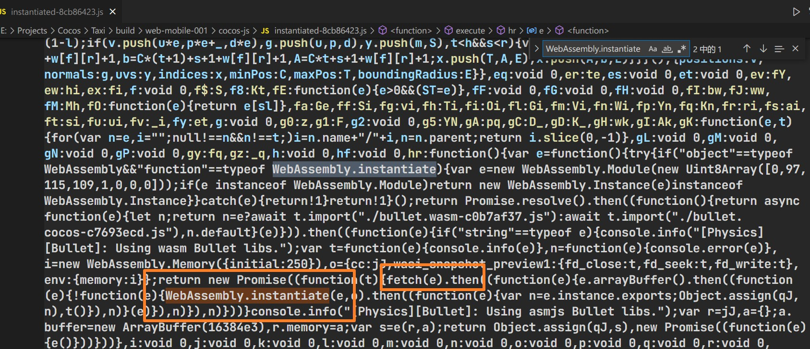
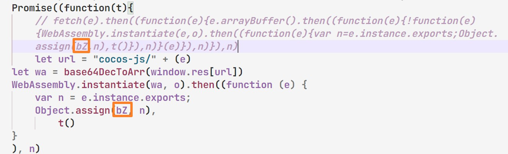

# CocosCreator3D jouableAD

### [Modifié en fonction de ce projet](https://github.com/Jecced/c3d2one)

### Merci encore à ce gars pour son projet

## Description du fichier README

-   [Anglais](README.en.md)
-   [Chinois simplifié](README.zh-CN.md)
-   [Chinois traditionnel](README.zh-TW.md)
-   [hindi](README.hi.md)
-   [Française](README.fr.md)
-   [arabe](README.ar.md)

### Version historique

## [CocosCreator3D 3.2.0](./version/Version%203.2.0.md)

## [CocosCreator3D 3.4.1](./version/Version%203.4.1.md)

## Principe de fabrication

### Parce que CocosCreator est utilisé depuis la version 3d[SystèmeJS](https://github.com/systemjs/systemjs)pour charger toutes les ressources de script, mais la façon dont SystemJS charge les scripts se fait via des requêtes Web (la méthode est peut-être incorrecte), mais la condition préalable à la production d'annonces jouables est que les ressources ne soient pas autorisées à être chargées via des requêtes réseau. Toutes les ressources associées doivent être dans le même fichier HTML, la première version a donc été chargée en modifiant SystemJS. Cependant, après de nombreux tests (de longue date), des méthodes très astucieuses ont été trouvées, réalisables sans modifier SystemJS.

#### [Système.register](https://github.com/systemjs/systemjs/blob/main/docs/system-register.md)

Une fois que CocosCreator3D a exporté le projet Web mobile, de nombreux scripts liés au système présentent les caractéristiques suivantes. Pour les scripts enregistrés auprès de SystemJS, le premier tableau contient des dépendances, qui représentent les modules qui en dépendent. Les modules dépendants seront chargés en premier.

```javascript
System.register(['dependency'], function (_export, _context) {
  var dep;
  return {
    setters: [function (_dep) {
      dep = _dep;
    }],
    execute: function () {
      _export({
        name: 'value'
      });
    }
  };
});
```

Ensuite, le premier paramètre de la méthode System.register peut être transmis dans une chaîne, que j'appelle un alias. Il s'agit généralement du nom du fichier js plus le chemin correspondant. Étant donné qu'il existe de nombreux fichiers js portant le même nom de fichier, ceux-ci seront traités en conséquence, comme suit. Par exemple, si le fichier js est PPS.js, il peut être modifié comme suit :

```javascript
System.register('./PPS.js'，['./PPY.js'], function (_export, _context) {
  var dep;
  return {
    setters: [function (_dep) {
      dep = _dep;
    }],
    execute: function () {
      _export({
        name: 'value'
      });
    }
  };
});
```

Ce qui précède signifie que lorsque PPS.js est chargé, le fichier PPY.js sera chargé en premier, puis PPS.js sera chargé.
Ci-dessous se trouve le fichier PPYjs,

```javascript
System.register('./PPY.js'，[], function (_export, _context) {
  var dep;
  return {
    setters: [function (_dep) {
      dep = _dep;
    }],
    execute: function () {
      _export({
        name: 'value'
      });
    }
  };
});
```

Injectez ensuite PPY.js et PPS.js dans le fichier HTML, semblable à ce qui suit

```html

<script>
  System.register('./PPS.js'，['./PPY.js'], function (_export, _context) {
  var dep;
  return {
    setters: [function (_dep) {
      dep = _dep;
    }],
    execute: function () {
      _export({
        name: 'value'
      });
    }
  };
});
</script>
<script>
   System.register('./PPY.js'，[], function (_export, _context) {
  var dep;
  return {
    setters: [function (_dep) {
      dep = _dep;
    }],
    execute: function () {
      _export({
        name: 'value'
      });
    }
  };
});
</script>
<script>
   System.import('./PPS.js').catch(function (err) {
        console.error(err);
    })
</script>
```

(Si vous souhaitez exécuter l'exemple normalement, le principe est d'injecter le module SystemJS, sinon il ne fonctionnera pas normalement) Le code en bas sera exécuté avec succès

Ce qui précède est un exemple simple. Ce projet utilise cette méthode pour effectuer de nombreux traitements correspondants, puis génère un seul fichier HTML.

## WASM加载文件处理

Puisque vous aurez peut-être besoin d'un module de moteur physique, vous pouvez également choisir un module WASM. Dans ce cas, vous devez modifier le code source du moteur (ouvrir "project directory/build/web-mobile/cocos-js/instantiated-\*\*.js" similaire à ce fichier)
Rechercher les champs clés

```javascript
WebAssembly.instantiate()
```

Comme le montre l'image, vous constaterez que la méthode de récupération est utilisée dans le script, ce qui n'est pas autorisé par PlayableAD, vous ne pouvez donc modifier que la méthode de récupération correspondante et la remplacer comme suit (l'adresse du chemin provient de[Traitement entrant du chemin WASM](./README.md#wasm路径传入处理))

Il est nécessaire de faire attention aux situations suivantes (très importantes) où les emplacements marqués doivent être les mêmes que ceux du fetch, car les noms des variables correspondantes seront modifiés à chaque compilation.

```javascript
let url = "cocos-js/" + (e)
let wa = base64DecToArr(window.res[url])
WebAssembly.instantiate(wa, o).then((function (e) {
    var n = e.instance.exports;
    Object.assign(qJ, n),
        t()
}
), n) 
```

Ce script obtient le chemin de la ressource wasm entrante. Toutes les ressources texte et ressources binaires existent dans window.res.

## Traitement entrant du chemin WASM

Ouvrez "project directory/build/web-mobile/cocos-js/bullet.wasm-\*\*\*\*.js" similaire à ce fichier

```javascript
System.register([],(function(e,t){"use strict";return{execute:function(){
  e("default",new URL("assets/bullet.wasm-c98527b6.wasm",t.meta.url).href)}
  }}));

```

Remplacez l'intégralité du paramètre 'new URL()' par 'assets/bullet.wasm-c98527b6.wasm', ce qui est très bien. Le nom du fichier wasm dans la version CocosCreator3D 3.4.1 ne doit pas changer lors de l'empaquetage (s'il y a une modification, veuillez le remplacer par le nom de fichier correct)
Comme suit :

```javascript
System.register([],(function(e,t){"use strict";return{execute:function(){
    e("default","assets/bullet.wasm-c98527b6.wasm")
}}}));

```

# Actions à réaliser

[traitement de chargement wasm](./README.md#wasm加载文件处理)\|[Traitement entrant du chemin WASM](./README.md#wasm路径传入处理)Cette opération est nécessaire car la méthode d'opération de récupération JavaScript est utilisée, qui ne peut forcer que la modification du code source du moteur (elle peut être ignorée si wasm n'est pas utilisé)
