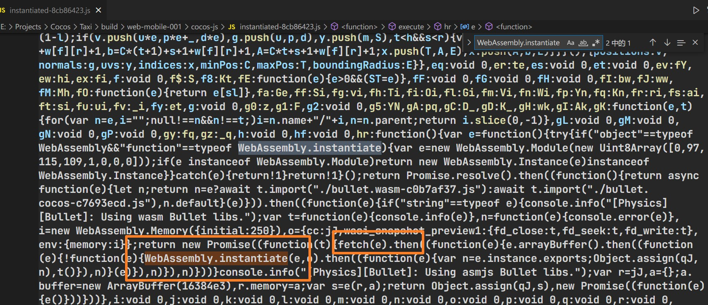
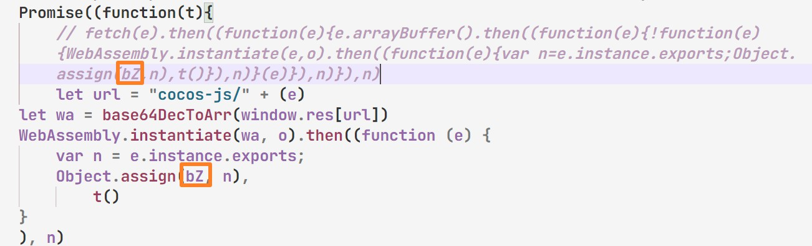

# CocosCreator3D PlayableAD

### [इस परियोजना के आधार पर संशोधित](https://github.com/Jecced/c3d2one)

### इस व्यक्ति को उसके प्रोजेक्ट के लिए एक बार फिर धन्यवाद

## पढ़ें विवरण

-   [अंग्रेज़ी](README.en.md)
-   [सरलीकृत चीनी](README.zh-CN.md)
-   [परंपरागत चीनी](README.zh-TW.md)
-   [हिंदी](README.hi.md)
-   [फ़्रेंच](README.fr.md)
-   [अरब](README.ar.md)

### ऐतिहासिक संस्करण

## [CocosCreator3D 3.2.0](./version/Version%203.2.0.md)

## [CocosCreator3D 3.4.1](./version/Version%203.4.1.md)

## उत्पादन सिद्धांत

### क्योंकि CocosCreator का उपयोग 3डी संस्करण से किया जा रहा है[सिस्टमजेएस](https://github.com/systemjs/systemjs)सभी स्क्रिप्ट संसाधनों को लोड करने के लिए, लेकिन जिस तरह से SystemJS स्क्रिप्ट को लोड करता है वह वेब अनुरोधों के माध्यम से होता है (शायद विधि गलत है), लेकिन प्लेएबल विज्ञापन उत्पादन के लिए शर्त यह है कि संसाधनों को नेटवर्क अनुरोधों के माध्यम से लोड करने की अनुमति नहीं है। सभी संबंधित संसाधन एक ही HTML फ़ाइल में होने चाहिए, इसलिए SystemJS को संशोधित करके प्रारंभिक संस्करण लोड किया गया था। हालाँकि, कई परीक्षणों (लंबे समय तक) के बाद, कुछ बहुत ही चतुर तरीके पाए गए, जो SystemJS को संशोधित किए बिना किया जा सकता है।

#### [सिस्टम.रजिस्टर](https://github.com/systemjs/systemjs/blob/main/docs/system-register.md)

CocosCreator3D मोबाइल वेब प्रोजेक्ट को निर्यात करने के बाद, इसमें कई सिस्टम-संबंधित स्क्रिप्ट में निम्नलिखित विशेषताएं हैं। SystemJS के साथ पंजीकृत स्क्रिप्ट के लिए, पहले सरणी में निर्भरताएँ होती हैं, जो उन मॉड्यूल का प्रतिनिधित्व करती हैं जो उन पर निर्भर हैं। आश्रित मॉड्यूल पहले लोड किए जाएंगे।

```javascript
System.register(['dependency'], function (_export, _context) {
  var dep;
  return {
    setters: [function (_dep) {
      dep = _dep;
    }],
    execute: function () {
      _export({
        name: 'value'
      });
    }
  };
});
```

फिर System.register विधि का पहला पैरामीटर एक स्ट्रिंग में पारित किया जा सकता है, जिसे मैं उपनाम कहता हूं। यह आमतौर पर जेएस फ़ाइल का नाम और संबंधित पथ होता है। क्योंकि एक ही फ़ाइल नाम वाली कई js फ़ाइलें हैं, इन्हें निम्नलिखित की तरह तदनुसार संसाधित किया जाएगा। उदाहरण के लिए, यदि js फ़ाइल PPS.js है, तो इसे निम्नानुसार संशोधित किया जा सकता है:

```javascript
System.register('./PPS.js'，['./PPY.js'], function (_export, _context) {
  var dep;
  return {
    setters: [function (_dep) {
      dep = _dep;
    }],
    execute: function () {
      _export({
        name: 'value'
      });
    }
  };
});
```

उपरोक्त का मतलब है कि जब PPS.js लोड किया जाता है, तो PPY.js फ़ाइल पहले लोड की जाएगी, और फिर PPS.js लोड की जाएगी।
नीचे PPYjs फ़ाइल है,

```javascript
System.register('./PPY.js'，[], function (_export, _context) {
  var dep;
  return {
    setters: [function (_dep) {
      dep = _dep;
    }],
    execute: function () {
      _export({
        name: 'value'
      });
    }
  };
});
```

फिर निम्न के समान, PPY.js और PPS.js को Html फ़ाइल में इंजेक्ट करें

```html

<script>
  System.register('./PPS.js'，['./PPY.js'], function (_export, _context) {
  var dep;
  return {
    setters: [function (_dep) {
      dep = _dep;
    }],
    execute: function () {
      _export({
        name: 'value'
      });
    }
  };
});
</script>
<script>
   System.register('./PPY.js'，[], function (_export, _context) {
  var dep;
  return {
    setters: [function (_dep) {
      dep = _dep;
    }],
    execute: function () {
      _export({
        name: 'value'
      });
    }
  };
});
</script>
<script>
   System.import('./PPS.js').catch(function (err) {
        console.error(err);
    })
</script>
```

(यदि आप उदाहरण को सामान्य रूप से चलाना चाहते हैं, तो इसका आधार SystemJS मॉड्यूल को इंजेक्ट करना है, अन्यथा यह सामान्य रूप से नहीं चलेगा) नीचे दिए गए कोड को सफलतापूर्वक निष्पादित किया जाएगा

उपरोक्त एक सरल उदाहरण है. यह प्रोजेक्ट बहुत सी संबंधित प्रोसेसिंग करने के लिए इस विधि का उपयोग करता है और फिर एक एकल HTML फ़ाइल उत्पन्न करता है।

## WASM फ़ाइल प्रसंस्करण लोड हो रहा है

चूँकि आपको भौतिकी इंजन मॉड्यूल की आवश्यकता हो सकती है, आप WASM मॉड्यूल भी चुन सकते हैं। इस मामले में, आपको इंजन स्रोत कोड को संशोधित करने की आवश्यकता है (इस फ़ाइल के समान "प्रोजेक्ट डायरेक्टरी/बिल्ड/वेब-मोबाइल/कोकोस-जेएस/इंस्टेंटियेटेड-\*\*.जेएस" खोलें)
प्रमुख फ़ील्ड ढूंढें

```javascript
WebAssembly.instantiate()
```

जैसा कि चित्र में दिखाया गया है, आप पाएंगे कि स्क्रिप्ट में फ़ेच विधि का उपयोग किया गया है, जिसे PlayableAD द्वारा अनुमति नहीं है, इसलिए आप केवल संबंधित फ़ेच विधि को बदल सकते हैं और इसे निम्नानुसार बदल सकते हैं (पथ पता से आता है)[WASM पथ इनकमिंग प्रोसेसिंग](./README.md#wasm路径传入处理))

निम्नलिखित स्थितियों पर ध्यान देना आवश्यक है (बहुत महत्वपूर्ण) जहां चिह्नित स्थान फ़ेच में समान होने चाहिए, क्योंकि हर बार जब आप संकलन करेंगे तो संबंधित चर नाम बदल दिए जाएंगे।

```javascript
let url = "cocos-js/" + (e)
let wa = base64DecToArr(window.res[url])
WebAssembly.instantiate(wa, o).then((function (e) {
    var n = e.instance.exports;
    Object.assign(qJ, n),
        t()
}
), n) 
```

यह स्क्रिप्ट आने वाले wasm संसाधन का पथ प्राप्त करती है। सभी टेक्स्ट संसाधन और बाइनरी संसाधन window.res में मौजूद हैं।

## WASM पथ इनकमिंग प्रोसेसिंग

इस फ़ाइल के समान "प्रोजेक्ट निर्देशिका/बिल्ड/वेब-मोबाइल/कोकोस-जेएस/बुलेट.वासम-\*\*\*\*.जेएस" खोलें

```javascript
System.register([],(function(e,t){"use strict";return{execute:function(){
  e("default",new URL("assets/bullet.wasm-c98527b6.wasm",t.meta.url).href)}
  }}));

```

'नए URL()' के संपूर्ण पैरामीटर को 'assets/bullet.wasm-c98527b6.wasm' से बदलें, जो बहुत अच्छा है। पैकेजिंग के समय CocosCreator3D 3.4.1 संस्करण में wasm फ़ाइल का नाम नहीं बदलना चाहिए (यदि कोई संशोधन है, तो कृपया इसे सही फ़ाइल नाम से बदलें)
इस प्रकार:

```javascript
System.register([],(function(e,t){"use strict";return{execute:function(){
    e("default","assets/bullet.wasm-c98527b6.wasm")
}}}));

```

# क्रियाएं जो की जानी चाहिए

[wasm लोडिंग प्रोसेसिंग](./README.md#wasm加载文件处理)\|[WASM पथ इनकमिंग प्रोसेसिंग](./README.md#wasm路径传入处理)यह ऑपरेशन आवश्यक है क्योंकि जावास्क्रिप्ट फ़ेच ऑपरेशन विधि का उपयोग किया जाता है, जो केवल इंजन स्रोत कोड के संशोधन को बाध्य कर सकता है (यदि wasm का उपयोग नहीं किया जाता है तो इसे अनदेखा किया जा सकता है)
