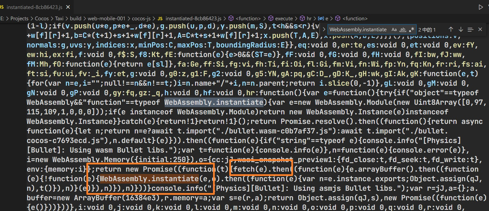
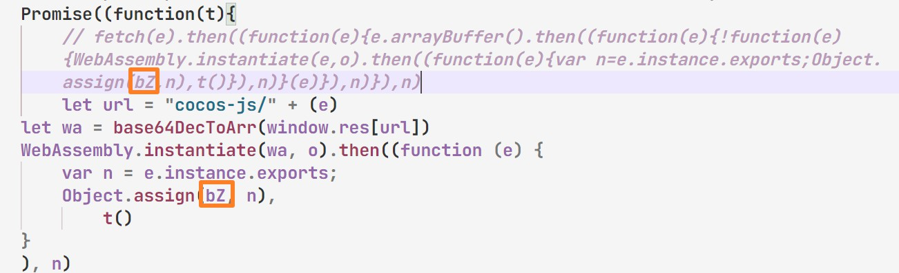

# CocosCreator3D 可玩AD

### [基於該項目修改](https://github.com/Jecced/c3d2one)

### 再次感謝該大佬的項目

## README 說明

-   [英語](README.en.md)
-   [簡體中文](README.zh-CN.md)
-   [繁體中文](README.zh-TW.md)
-   [印地語](README.hi.md)
-   [法語](README.fr.md)
-   [阿拉伯](README.ar.md)

### 歷史版本

## [CocosCreator3D 3.2.0](./version/Version%203.2.0.md)

## [CocosCreator3D 3.4.1](./version/Version%203.4.1.md)

## 製作原理

### 因為CocosCreator 從3d版本後就開始通過用[系統JS](https://github.com/systemjs/systemjs)來加載所有的腳本資源，但是SystemJS加載腳本的方式是透過web請求方式（可能方法說得不對）來加載腳本，但是Playable廣告製作的前提條件就是不允許通過網絡請求來加載資源，所有相關的資源必須要在同一個Html文件裡面，所以早期版本是通過很久的魔法

#### [System.register](https://github.com/systemjs/systemjs/blob/main/docs/system-register.md)

CocosCreator3D 匯出手機web專案後，裡面很多系統相關的腳本都有以下特徵，SystemJS註冊的腳本，第一個陣列裡面是依賴項，代表依賴那些模組，會優先載入依賴模組

```javascript
System.register(['dependency'], function (_export, _context) {
  var dep;
  return {
    setters: [function (_dep) {
      dep = _dep;
    }],
    execute: function () {
      _export({
        name: 'value'
      });
    }
  };
});
```

然後System.register方法的第一個參數可以傳入string，這個我稱之為別名，通常是js文件的名稱加上對應路徑，因為有很多相同文件名的js文件，這些會做一些對應處理，像下面這樣，比如該js文件為PPS.js,可以修改如下：

```javascript
System.register('./PPS.js'，['./PPY.js'], function (_export, _context) {
  var dep;
  return {
    setters: [function (_dep) {
      dep = _dep;
    }],
    execute: function () {
      _export({
        name: 'value'
      });
    }
  };
});
```

以上表示PPS.js在載入的時候會優先載入PPY.js文件，然後再載入PPS.js,
下面是PPYjs檔,

```javascript
System.register('./PPY.js'，[], function (_export, _context) {
  var dep;
  return {
    setters: [function (_dep) {
      dep = _dep;
    }],
    execute: function () {
      _export({
        name: 'value'
      });
    }
  };
});
```

然后把PPY.js,PPS.js注入到Html文件中，类似如下

```html

<script>
  System.register('./PPS.js'，['./PPY.js'], function (_export, _context) {
  var dep;
  return {
    setters: [function (_dep) {
      dep = _dep;
    }],
    execute: function () {
      _export({
        name: 'value'
      });
    }
  };
});
</script>
<script>
   System.register('./PPY.js'，[], function (_export, _context) {
  var dep;
  return {
    setters: [function (_dep) {
      dep = _dep;
    }],
    execute: function () {
      _export({
        name: 'value'
      });
    }
  };
});
</script>
<script>
   System.import('./PPS.js').catch(function (err) {
        console.error(err);
    })
</script>
```

（如果想要正常運作範例，前提是注入SystemJS模組，否則無法正常運作）最下方的程式碼會成功執行

以上是簡單的範例，該工程就是透過此方法做了大量對應處理，然後產生單一Html檔案的

## WASM載入檔案處理

由於可能需要實體引擎模組，當然也可能會選擇WASM模組，這種情況就需要魔改一丟丟引擎原始碼（開啟「專案目錄/build/web-mobile/cocos-js/instantiated-\*\*.js」類似這個檔案）
尋找關鍵字段

```javascript
WebAssembly.instantiate()
```

如圖，你會發現腳本裡面使用了fetch方法，這是PlayableAD 不允許的，所以只能更改對應fetch方法，替換如下(路徑地址來自[WASM路徑傳入處理](./README.md#wasm路径传入处理))

需要注意以下情況（很重要）其中標記的地方需要跟fetch中的一樣，因為每次編譯都會改變對應變數命名

```javascript
let url = "cocos-js/" + (e)
let wa = base64DecToArr(window.res[url])
WebAssembly.instantiate(wa, o).then((function (e) {
    var n = e.instance.exports;
    Object.assign(qJ, n),
        t()
}
), n) 
```

該段腳本取得傳入的wasm資源的路徑，所有的文字資源與二進位資源全部存在於window.res中

## WASM路徑傳入處理

開啟「專案目錄/build/web-mobile/cocos-js/bullet.wasm-\*\*\*\*.js」類似這個文件

```javascript
System.register([],(function(e,t){"use strict";return{execute:function(){
  e("default",new URL("assets/bullet.wasm-c98527b6.wasm",t.meta.url).href)}
  }}));

```

替換‘new URL()’整個參數為’assets/bullet.wasm-c98527b6.wasm‘，很不錯，wasm文件的名稱在CocosCreator3D 3.4.1版本的名稱在打包的時候應該不會改變（如果有修改，請替換為正確的文件名稱）
如下：

```javascript
System.register([],(function(e,t){"use strict";return{execute:function(){
    e("default","assets/bullet.wasm-c98527b6.wasm")
}}}));

```

# 必須要執行的操作

[wasm載入處理](./README.md#wasm加载文件处理)\|[WASM路徑傳入處理](./README.md#wasm路径传入处理)這個操作是必須的，因為用到了JavaScript fetch操作方法，只能強制修改引擎源碼（如果沒有使用wasm可以忽略）
